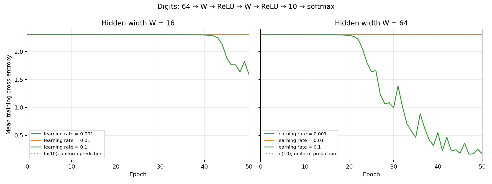

# Lab 02 — A neural network from scratch

## 1. Goal and method

The network uses NumPy for forward propagation, cross-entropy, backpropagation and mini-batch SGD. scikit-learn is used only for `load_digits` and the stratified split; no neural-network framework or automatic differentiation is used.

The 1,797 images have 64 pixel values each. Inputs are divided by 16 and labels are one-hot encoded. The stratified 70/30 split with `random_state=42` gives 1,257 training images and 540 test images. Initialization and shuffling also use seed 42. Each experiment starts with fresh weights from N(0, 0.01²), zero biases, and the same batch order. Training uses batches of 32 (the final batch has 9 images), 50 epochs and plain SGD. Test accuracy is measured after training; the test set does not control updates or stopping.

The architecture and chain-rule derivation are in [derivation.md](derivation.md).

## 2. Sanity checks and gradient checking

| Width | Initial batch loss | Passed random weights | Max relative error |
|---:|---:|---:|---:|
| 16 | 2.30259513 | 10/10 | 1.760e-12 |
| 64 | 2.30262309 | 10/10 | 9.801e-11 |

Both initial losses are close to ln(10) = 2.302585. Assertions check the output shape (32, 10), row sums with absolute tolerance 1e-6 and zero relative tolerance, and all gradient shapes.

For each width, 10 distinct random weights across all three layers are perturbed by ±1e-5. Relative error is `abs(analytic - numeric) / (abs(analytic) + abs(numeric))`; zero/zero is defined as zero. At least 9/10 must be below 1e-6 or execution fails. No failing weights are discarded.

With the required small initialization, some slopes are tiny. Subtracting two ordinary float64 losses near 2.3026 loses precision. The numerical check therefore evaluates CE − ln(10) using `expm1` and `log1p` before central differencing. Subtracting this constant leaves the mathematical gradient unchanged. Training uses stable log-softmax cross-entropy. Full analytical and numerical values are in `results/gradient_checks.csv`.

## 3. Training results

| Width | Learning rate | Final train loss | Train accuracy | Test accuracy |
|---:|---:|---:|---:|---:|
| 16 | 0.001 | 2.302550 | 10.18% | 10.19% |
| 16 | 0.01 | 2.302476 | 10.18% | 10.19% |
| 16 | 0.1 | 1.597017 | 32.22% | 32.59% |
| 64 | 0.001 | 2.302526 | 10.18% | 10.19% |
| 64 | 0.01 | 2.302343 | 10.18% | 10.19% |
| 64 | 0.1 | 0.168405 | 94.67% | 93.89% |



The highest observed test accuracy is 93.89% at W=64 and learning rate 0.1. This is a descriptive comparison of the six assigned experiments, not an independent validation-based model selection.

Small learning rates can remain near the uniform-prediction loss within 50 epochs because small weights attenuate the signals through both hidden layers. A wider network has more parameters and more matrix multiplication work. Width alone does not determine accuracy; the learning rate and fixed training budget also matter.

## 4. Forward and backward timing

Each trained model is timed on the same batch of 32 images. After 10 warm-up iterations, the median of 100 runs is recorded with `perf_counter_ns`. Backward uses a precomputed cache, so its measurement excludes forward propagation, loss evaluation and SGD updates. Forward includes softmax and cache construction. Raw timings are in `results/timing_runs.csv`.

| Width | Learning rate | Forward (µs) | Backward (µs) | Backward/forward |
|---:|---:|---:|---:|---:|
| 16 | 0.001 | 28.750 | 28.917 | 1.01 |
| 16 | 0.01 | 28.375 | 28.916 | 1.02 |
| 16 | 0.1 | 29.375 | 29.584 | 1.01 |
| 64 | 0.001 | 71.916 | 75.792 | 1.05 |
| 64 | 0.01 | 73.478 | 76.604 | 1.04 |
| 64 | 0.1 | 107.229 | 121.521 | 1.13 |

Backward is slower in 6 of the 6 measured configurations. Forward uses three matrix products: XW1, A1W2 and A2W3. Backward uses five: three weight-gradient products and two products propagating the gradient into hidden layers. The input gradient is not needed. Ignoring elementwise operations and counting multiply/add as two FLOPs, forward costs 2B(64W + W² + 10W), while backward costs 2B(64W + 2W² + 20W). Their arithmetic ratio is about 1.29 for W=16 and 1.54 for W=64. Small matrices also incur Python, allocation, softmax and reduction overhead, so wall-clock ratios need not equal these estimates and can favor either pass. These timings describe this machine and run, not a universal performance guarantee.

## 5. Reproducibility

Run from the repository root:

```bash
.venv/bin/python lab02/perceptron.py

# Additional checks, including bias gradients and extreme logits:
.venv/bin/python -m unittest discover -s lab02 -p 'test_*.py' -v
```

The script writes all results relative to its own location, so it also works when launched from PyCharm with a different working directory. `results/training_log.csv` contains all 300 epoch records; `results/summary.csv` contains final test accuracy and timing for all six runs. `results/environment.json` records the runtime versions.

Measured environment: Python 3.11.8, NumPy 1.26.4, scikit-learn 1.5.0, Matplotlib 3.9.0; macOS-15.7.1-arm64-arm-64bit.
