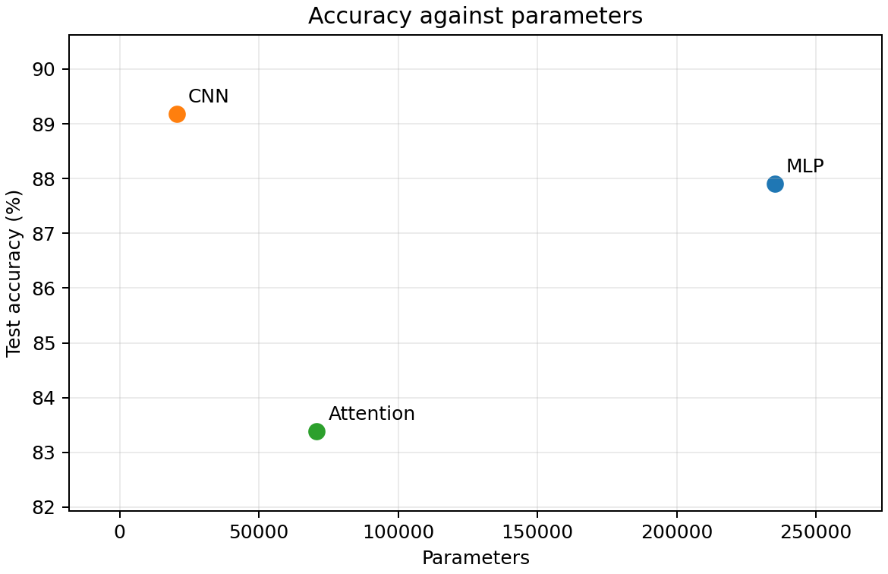
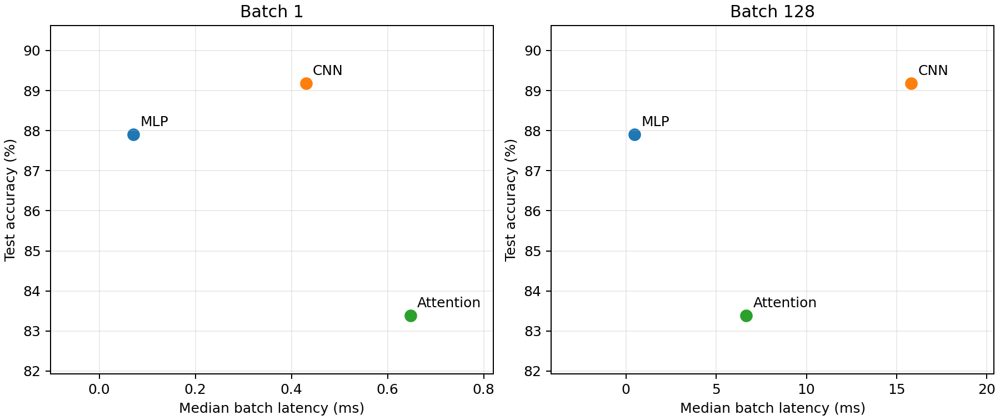

# Lab 3: Architectures and their costs

## 1. Dataset

Fashion-MNIST is loaded with `torchvision.datasets.FashionMNIST`, using `ToTensor()` and `Normalize((0.2860,), (0.3530,))`. The official 60,000 training examples are split into 55,000 training and 5,000 validation examples with seed 42. The official 10,000 test examples are kept separate. Batch size is 128, including the final partial batch. Transformed tensors are cached in memory without changing their values.

## 2. Architectures

- MLP: Flatten 784 → Linear 256 → ReLU → Linear 128 → ReLU → Linear 10.
- CNN: Conv2d(1,16,3,padding=1) → ReLU → MaxPool2d(2) → Conv2d(16,32,3,padding=1) → ReLU → MaxPool2d(2) → Flatten → Linear(1568,10).
- Attention: 16 non-overlapping 7×7 patches in raster order → Linear(49,64) → two Transformer encoder layers with d_model=64, nhead=4 and dim_feedforward=128 → mean pooling → Linear(64,10). Encoder layers use PyTorch defaults: ReLU, dropout 0.1 and post-layer normalization. No positional embeddings or class token are added because they are not specified.

Parameter counts from `torchinfo.summary`, including biases and normalization parameters:

| Model | Parameters |
|---|---:|
| MLP | 235,146 |
| CNN | 20,490 |
| Attention | 70,794 |

The requested 100k–150k target conflicts with the explicit architectures. The layer definitions are preserved exactly, so this comparison does not control for equal parameter counts. Full summaries are saved in `results/*_summary.txt`; their parameter totals are checked against `sum(p.numel() for p in model.parameters())`.

## 3. Compute cost and inference latency

### Hand calculations

One multiplication and one addition count as two FLOPs. Calculations use one image and count matrix products and convolutions; biases, activation functions, pooling, normalization, residual additions, softmax and mean pooling are excluded.

| Representative operation | Calculation | FLOPs |
|---|---|---:|
| MLP first Linear | 2 × 784 × 256 | 401,408 |
| CNN first Conv2d | 2 × 3 × 3 × 1 × 16 × 28 × 28 | 225,792 |
| Attention QKV projections | 2 × 16 × 64 × 3 × 64 | 393,216 |
| Attention scores, QKᵀ | 2 × 16² × 64 | 32,768 |
| Attention weighted values, AV | 2 × 16² × 64 | 32,768 |
| Attention output projection | 2 × 16 × 64 × 64 | 131,072 |

Four heads split the 64-dimensional representation into dimensions of 16; summing the heads gives the score/value calculations above. One complete multi-head attention module costs 589,824 FLOPs.

Whole-model totals:

- MLP: 2 × (784×256 + 256×128 + 128×10) = 469,504 FLOPs.
- CNN: 2 × (3²×1×16×28² + 3²×16×32×14² + 1568×10) = 2,063,488 FLOPs.
- Attention: patch projection 2×16×49×64 = 100,352; each encoder costs 589,824 + 2×16×64×128 + 2×16×128×64 = 1,114,112; classifier 2×64×10 = 1,280. Total: 100,352 + 2×1,114,112 + 1,280 = 2,329,856 FLOPs.

### Comparison with thop.profile

| Model | Hand core FLOPs | Default thop operation count | Adjusted thop core FLOPs |
|---|---:|---:|---:|
| MLP | 469,504 | 234,752 | 469,504 |
| CNN | 2,063,488 | 1,031,744 | 2,063,488 |
| Attention | 2,329,856 | 591,488 | 2,329,856 |

For Linear and Conv2d, `thop.profile` reports multiply-accumulates (MACs), so its count must be multiplied by two to match the hand convention. The default attention count is incomplete: functional QKV/output projections and attention matrix products inside `nn.MultiheadAttention` are missed, while LayerNorm adds 16,384 operations across four normalizations. Thus simply doubling its default count is not a consistent full FLOP estimate.

The adjusted profile adds a hook for multi-head attention with `4×seq×d² + 2×seq²×d` MACs per sample and excludes LayerNorm to match the hand-count scope. All three adjusted totals equal the hand calculations; the script asserts this equality. These are analytical operation counts observed through profiler hooks, not hardware performance-counter measurements. `torchinfo` is used for parameter counts, not as an attention FLOP reference.

### Latency protocol

All models run in evaluation mode under `torch.inference_mode()`, using float32 on CPU with four PyTorch intra-op threads. For each batch size, 10 warm-up forwards precede the measurements. Batch 1 uses the median of 100 runs; batch 128 uses the median of 20 runs. `perf_counter_ns` measures the forward pass only; input preparation and device transfer occur before timing. Accelerator synchronization is included if run on CUDA/MPS. MHA fast paths are disabled consistently for profiling, training and timing so hooks see the attention operations. Results describe this configuration and may differ with fused kernels enabled.

| Model | Test accuracy | Batch 1 (ms) | Batch 128 (ms) | Batch 128 ms/image |
|---|---:|---:|---:|---:|
| MLP | 87.90% | 0.0715 | 0.4608 | 0.00360 |
| CNN | 89.18% | 0.4299 | 15.7953 | 0.12340 |
| Attention | 83.38% | 0.6474 | 6.6600 | 0.05203 |

Raw measurements are in `results/timing_runs.csv`. Batch latency and per-image latency are different quantities; batching amortizes overhead and improves matrix utilization.

## 4. Training

Each model is trained from scratch for exactly 5 epochs with Adam, learning rate 0.001 and batch size 128. Cross-entropy receives raw logits. Initialization and batch shuffling use seed 42. Validation is evaluated after each epoch; it does not select a checkpoint. Test accuracy is measured once per model after epoch 5. All parameters, including normalization parameters, are trained.

| Model | Epoch | Train loss | Validation accuracy |
|---|---:|---:|---:|
| MLP | 1 | 0.4919 | 84.68% |
| MLP | 2 | 0.3537 | 86.04% |
| MLP | 3 | 0.3135 | 86.80% |
| MLP | 4 | 0.2899 | 88.04% |
| MLP | 5 | 0.2692 | 88.36% |
| CNN | 1 | 0.5295 | 84.72% |
| CNN | 2 | 0.3510 | 87.04% |
| CNN | 3 | 0.3051 | 88.78% |
| CNN | 4 | 0.2795 | 88.64% |
| CNN | 5 | 0.2625 | 89.78% |
| Attention | 1 | 0.8289 | 79.02% |
| Attention | 2 | 0.5465 | 80.80% |
| Attention | 3 | 0.4852 | 82.94% |
| Attention | 4 | 0.4495 | 84.10% |
| Attention | 5 | 0.4283 | 84.02% |

Final test accuracies are in the table in section 3 and `results/summary.csv`. The complete training log is in `results/training_log.csv`.

## 5. Accuracy and cost trade-offs





The CNN reuses each small convolution kernel across spatial locations and uses local receptive fields. Pooling reduces feature-map dimensions before the classifier. This gives substantial weight reuse and a small parameter footprint, although intermediate feature maps and convolution work still contribute to latency. Dense MLP layers use regular matrix products, which become more efficient with batching. At batch 1, the large first weight matrix has relatively little reuse across examples; flattening also removes the explicit local image structure.

Attention projects all patches, mixes them globally through QKᵀ and AV, and applies feed-forward layers. Its score matrix grows quadratically with sequence length. Here the sequence has only 16 patches, so projections and feed-forward matrix products dominate core arithmetic. Normalization, residual paths, reshaping and multiple kernel calls also create memory traffic and overhead that parameter count alone does not predict. Without positional embeddings, the encoder and mean pool do not represent the order of patches; this limits spatial information in the prescribed model.

These access patterns explain why fewer weights or FLOPs do not guarantee lower latency: weight/activation movement, reuse, batching and operator scheduling matter alongside arithmetic. The CNN gives the highest accuracy (89.18%) and the smallest model (20,490 parameters), making it the most cost-effective choice when accuracy and storage are the priorities. The MLP is fastest at both batch sizes: 0.0715 ms for one image and 0.4608 ms for 128 images, with 87.90% accuracy. It is preferable when latency matters most and its larger weight storage is acceptable. Attention achieves 83.38% accuracy; its batch-128 latency (6.6600 ms) is lower than the CNN's (15.7953 ms), despite having more core FLOPs, while its batch-1 latency is higher. This illustrates the effect of operator implementation and batching. The conclusion is limited to the specified architectures, five-epoch training budget and measured CPU configuration.

## 6. Reproduction and commit

Run from the repository root:

```bash
.venv/bin/python lab03/main.py
```

Environment: Python 3.11.8, PyTorch 2.3.1, macOS 15.7.1 arm64, CPU, four threads, seed 42. Runtime settings and split sizes are recorded in `results/environment.json`. The implementation, report and measured results are committed together.
