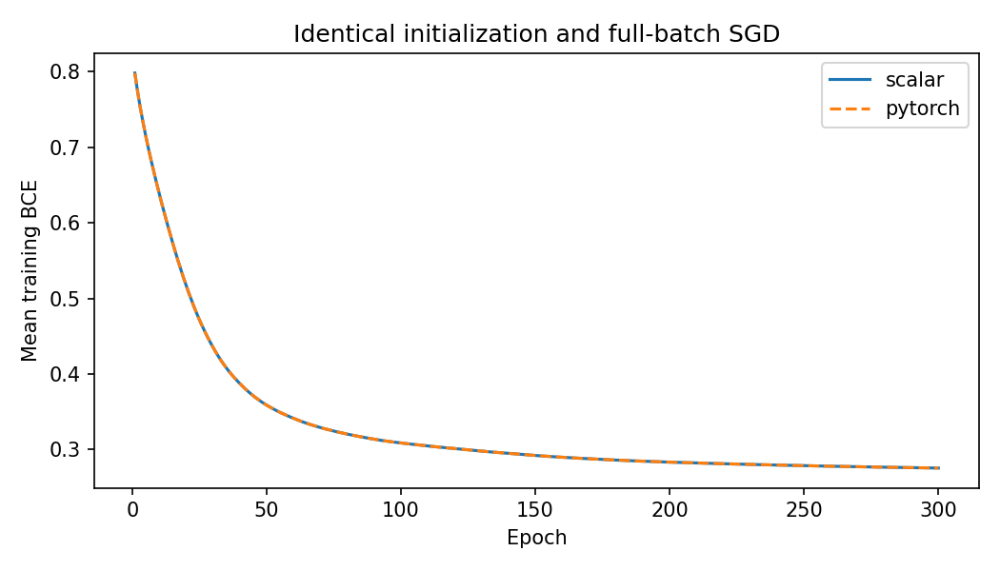
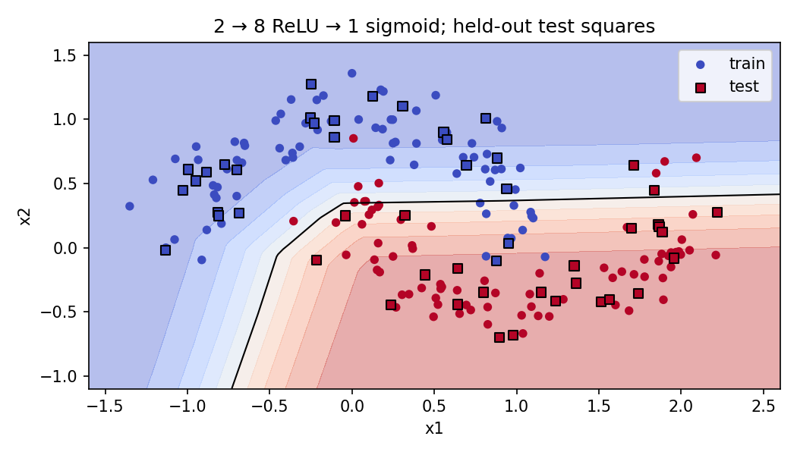

# Lab 05 - Frameworks and automatic differentiation

Student: Valeriia Khapilina, 73438.

## 1. Scalar graph engine

Implemented `Value` in `../src/autodiff.py`. Every node stores a floating-point
value, gradient, ordered parent references, operation label and local backward
rule. Operators construct new nodes during the forward pass. Parent references
retain repeated operands: `x*x` has two contributions even though `x` is visited
only once in the graph traversal.

The engine implements reverse-mode automatic differentiation. It applies local
derivatives to the operations actually executed, rather than symbolically
rewriting a formula or estimating derivatives by perturbing inputs. This follows
the graph-based mechanism described in [PyTorch autograd mechanics](https://docs.pytorch.org/docs/main/notes/autograd.html).

## 2. Operations and local derivatives

For upstream gradient g = dL/dz:

| Operation | Contribution to input gradients |
|---|---|
| z = a + b | a.grad += g; b.grad += g |
| z = a * b | a.grad += b*g; b.grad += a*g |
| z = a**p, constant p | a.grad += p*a**(p-1)*g |
| z = ReLU(a) | a.grad += (a > 0)*g |

ReLU's chosen derivative at zero is 0. Extra operations include subtraction,
division, exp, log, stable sigmoid and softplus. Their gradients are implemented
in the scalar engine; NumPy and PyTorch do not calculate its derivatives.

## 3. Topological backward pass

An iterative depth-first traversal produces a parent-before-child order without
Python recursion depth limits. The output gradient is set to 1, and nodes run
their local backward rules in reverse topological order. Gradients use `+=`
because shared nodes receive contributions along multiple paths. Internal
gradients are reset on a repeated backward call; leaf gradients accumulate.
Parameter gradients are explicitly zeroed before every training step.

Manual example: a=2, b=3, c=1; u=ab=6, v=u+c=7, L=ReLU(v²)=49.
The chain rule gives dL/dv=14, dL/du=14, dL/da=42, dL/db=28,
and dL/dc=14. `scalar_graph.dot` records these computed values and gradients.

Shared-node example: u=x*x, L=u*u+u+x. Then dL/dx=4x³+2x+1=115
at x=3. The test catches both repeated-operand and shared-branch errors.

## 4. Gradient verification

Checked `((a*b+c)**2).relu().sum()` on 25 seeded cases.
Each a, b and c contains four independent elements: the scalar engine reduces
four scalar graphs with Python `sum`; PyTorch uses its tensor `.sum()`.
For a single `Value`, `.sum()` is an identity. The ReLU after the square is
redundant for values; separate tests cover negative, zero and positive ReLU inputs.

| Check | Result |
|---|---:|
| Individual derivatives checked | 300 |
| Max absolute difference from PyTorch | 0.000e+00 |
| Max absolute difference from numerical estimates | 6.325e-10 |
| Required tolerance | < 1e-6 |

Both criteria passed. Numerical derivatives use central differences,
`[f(x+h)-f(x-h)]/(2h)`, with h=1e-05, float64, perturbing one
coordinate at a time. Full comparisons are in `gradients.csv`.

Unit tests additionally check graph order, a 3,000-operation chain, repeated
backward calls, reverse arithmetic, constant zero powers and stable BCE at logits
±1000. A complete model's loss, every parameter gradient and one SGD update are
checked against PyTorch at absolute tolerance 1e-12.

## 5. Tiny model on make_moons

Generated 200 points with noise=0.15 and seed=42.
A fixed stratified split contains 150 training and
50 test points. No test data are used for gradient updates or
parameter selection. Architecture: 2 -> 8 ReLU -> 1 sigmoid, with
33 trainable parameters.

For hidden features h=ReLU(W1*x+b1), the output logit is z=W2*h+b2 and
the predicted probability is sigmoid(z). The loss is mean binary cross-entropy.
Training computes it as `softplus(z)-y*z`, mathematically equal to
`-y*log(sigmoid(z))-(1-y)*log(1-sigmoid(z))`, with better numerical stability.
The scalar engine uses a stable custom softplus derivative; PyTorch uses
`binary_cross_entropy_with_logits`. Sigmoid is applied for reported predictions.

Both implementations use identical initial arrays, float64, CPU, full batches of
150, 300 epochs and SGD with learning rate 0.2.
Updates use the same explicit SGD formula without momentum or regularization.
No hyperparameter search was performed.

| Implementation | Median training time, s | Final training BCE | Held-out accuracy |
|---|---:|---:|---:|
| Scalar engine | 21.143493 | 0.275668 | 92.00% |
| PyTorch | 0.037341 | 0.275668 | 92.00% |

PyTorch was 566.2 times faster on this workload.
Maximum difference between final corresponding parameters:
4.441e-16. Maximum difference between
the two training loss curves: 5.551e-16.
Both must remain below 1e-8; the experiment asserts this before saving its summary.

Times are medians of five complete training runs from reset initial weights.
The timed region includes forward, backward, zeroing, updates and loss-history
collection; it excludes model construction, data conversion, warm-up, evaluation
and file writing. Scalar garbage collection stays enabled, so Python graph
allocation/collection overhead is included. Run order alternates. The comparison
includes vectorization and Python overhead; it does not isolate autograd alone.
Five identical-seed runs quantify timing variation, not model accuracy uncertainty.

## 6. Framework graphs, execution modes and tensor layout

### Graph inspection

`pytorch_autograd_graph.json` records 11 actual backward nodes and their
`next_functions` edges. Node types include
AccumulateGrad, AddmmBackward0, BinaryCrossEntropyWithLogitsBackward0, ReluBackward0, SqueezeBackward1, TBackward0.
The autograd graph represents derivative dependencies; the execution graph in
`pytorch_execution_graph.txt` represents forward tensor operations. They are
related but serve different purposes. `model_tensor_metadata.json` records
model input/output and parameter shape, dtype, strides and contiguity.

### Eager versus optimized execution

Selected path: `compile_inductor`. Reason: Inductor probe succeeded.
The original probe output is preserved in `compile_probe.log`.
The Inductor probe succeeded. The main-process setup can reuse compiler caches populated by the probe; it is not a cold installation/compiler-cache benchmark. First calls for each batch shape are also recorded separately.

The [PyTorch 2.3 tracing documentation](https://docs.pytorch.org/docs/2.3/generated/torch.jit.trace.html)
explains that tracing records the tensor operations executed on example inputs;
it does not capture arbitrary data-dependent Python control flow.

Setup in the main process took 1.384088 s, including first
execution. Below are medians of five runs, each 1,000 forward calls after 30 warm-up
calls, CPU, float64, inference mode, one thread. Model weights are fixed initial
weights for this independent performance study. The timed output is the logit;
the common output sigmoid is excluded from both paths. Input allocation, setup,
warm-up and correctness checks are excluded. Run order alternates.

| Batch | Eager, µs/call | Optimized, µs/call | Eager/optimized | Approx. setup break-even calls |
|---|---:|---:|---:|---:|
| 1 | 12.181 | 16.477 | 0.739 | never |
| 256 | 17.619 | 32.228 | 0.547 | never |
| 4096 | 60.467 | 73.095 | 0.827 | never |

The optimized path was slower at every measured batch size, even after warm-up. For this tiny CPU float64 network, eager execution is the better measured choice; setup cannot be amortized because no steady-state time was saved.

Break-even divides measured setup plus the first call for that shape by steady-state
time saved per call. It excludes the failed/successful probe process and, if used,
any compiler-cache cold start. It is a local estimate, not a deployment guarantee.

Graph optimization can help when repeatedly running the same supported workload:
less Python dispatch and opportunities to combine operations can reduce execution
cost. Initial setup must be amortized. Very short runs, unsupported operations,
shape specialization or memory-bound workloads may reduce or remove the benefit.
These measurements cover forward inference only; they do not establish training
speedups or make a general claim about all compilation backends.

### Non-contiguous tensors

Allocated a float64 backing tensor of shape (1024, 2048). `backing[:, ::2]`
is a non-contiguous view of shape (1024, 1024), sharing its backing storage.
Its contiguous copy contains exactly the same values, verified with zero tolerance.
Shape describes logical dimensions; dtype describes each element; strides give
steps in memory in units of elements. The contiguous layout has stride (1024, 1),
while the strided view skips every second stored element.

| Layout | Shape | dtype | Strides | Contiguous | Median add, µs |
|---|---|---|---|---|---:|
| strided_view | [1024, 1024] | torch.float64 | [2048, 2] | False | 724.645 |
| contiguous_copy | [1024, 1024] | torch.float64 | [1024, 1] | True | 328.538 |

Measured operation: `torch.add(x, 1, out=out)` with a shared preallocated contiguous
output. Five runs, 200 operations per run, 30 warm-up calls. Allocations are excluded
from the addition timing. Measured non-contiguous/contiguous ratio:
2.206. A separate contiguous materialization takes
612.740 µs; amortization would require
about 1.5 repeated additions, assuming comparable conditions.

The view touches a wider address range and has different cache behavior; this is
part of the layout comparison. Results are specific to this elementwise operation,
size and host. Non-contiguous views do not always slow every PyTorch operation,
and making a copy has its own time and memory cost. This is a warmed-cache CPU
microbenchmark, not a measurement of DRAM bandwidth or GPU kernels.

## Reproducibility and limits

Environment: macOS-27.2.1-arm64-arm-64bit; Python 3.11.8;
PyTorch 2.3.1; NumPy 1.26.4;
scikit-learn 1.5.0. CPU, one intra-op and one inter-op thread.
Timing uses `time.perf_counter`; no accelerator synchronization is needed.

Commands and artifact descriptions: [../README.md](../README.md).
Raw repeats remain in CSV, summaries in JSON, weights and split in NPZ. The report
is generated from those files by `../src/report.py`, without invented measurements.
There is one host and one data split; timing noise, cache effects and thermal state
limit generalization. The engine supports first-order scalar differentiation only.
