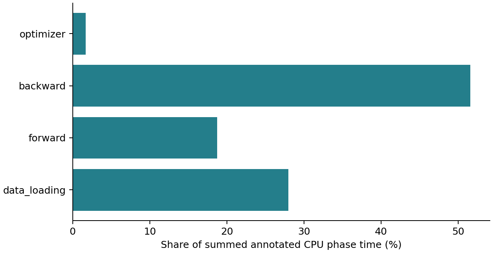
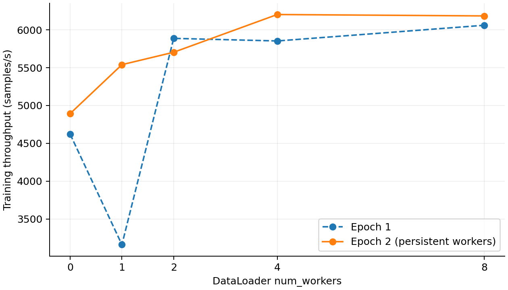
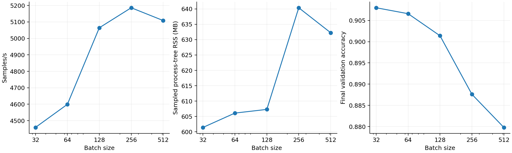
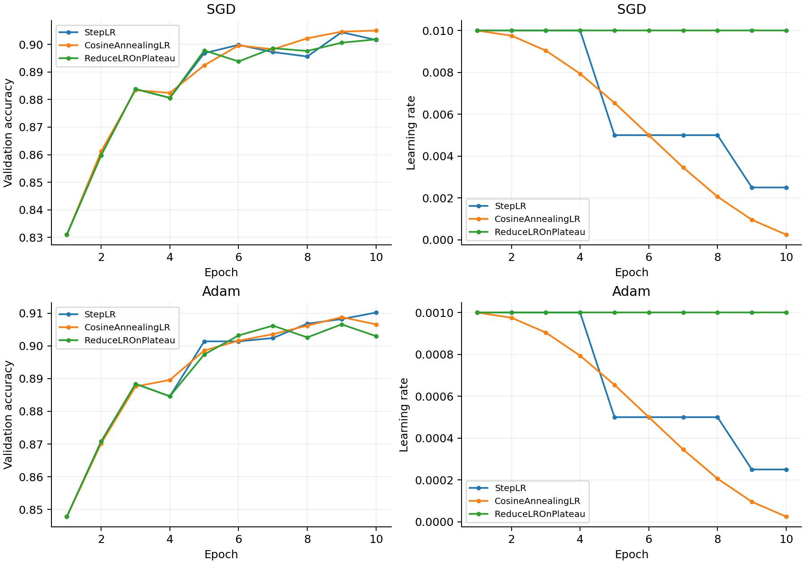
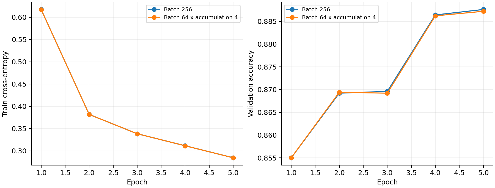
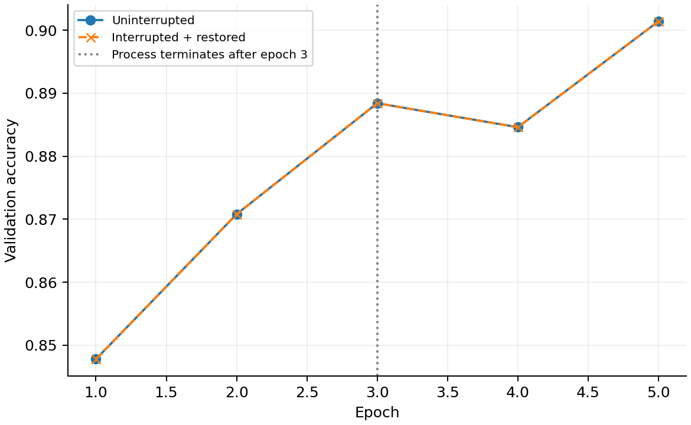

# Lab 6: Training pipelines and project proposal

Student: Valeriia Khapilina, 73438. Experiments executed 25 November 2026. Scheduled class: 18 November 2026.

## 1. Reproducible YAML pipeline [20]

The CNN from Lab 3 had the highest recorded accuracy (89.18%) and smallest parameter count (20,490). This lab retains its exact architecture. Lab 3 did not save weights, so all study runs start from the same seeded initialization, rather than claiming to restore an unavailable trained model.

One resolved YAML object drives data, seed, CPU threads, optimizer, schedule, batch size, workers, gradient accumulation, output and tracking. Each run stores its own YAML, environment, raw per-epoch metrics and checkpoint. MLflow logs flattened parameters, epoch metrics, final test metrics and all run artifacts. All 20 required runs completed; see `study_summary.csv` for run IDs. Runs are launched serially in separate processes to avoid concurrent training interference and allocator carryover.

Environment: Python 3.11.8, PyTorch 2.3.1, macOS-27.2.1-arm64-arm-64bit; CPU with 4 intra-op threads. The training-source image SHA256 is stored in every environment JSON; data_manifest.json additionally hashes labels, test images/labels and split indices. Fashion-MNIST uses the official 60,000/10,000 train/test sources, a seeded 55,000/5,000 train/validation split, ToTensor and normalization mean 0.2860/std 0.3530. Transforms execute per sample so the worker study measures a real loading/preprocessing path. No test data enter training or scheduling. Test accuracy is reported after each final study run as requested; conclusions and setting choices use validation accuracy, not the test ranking.

## 2. Full-epoch profiling [15]

| phase | cpu_time_ms | share_of_four_phases_percent | wall_seconds |
| --- | --- | --- | --- |
| data_loading | 3382.30 | 28.00 | 3.394 |
| forward | 2263.27 | 18.74 | 2.267 |
| backward | 6230.19 | 51.58 | 6.235 |
| optimizer | 203.72 | 1.69 | 0.207 |

Every batch in one complete 55,000-example epoch is instrumented with torch.profiler on CPU. Each batch's trace is aggregated and released before the next batch to bound profiler memory. The four disjoint record_function scopes surround next(iterator), forward plus loss, backward, and gradient normalization/optimizer step/zero_grad. Percentages use inclusive CPU duration of these scopes divided by their sum; nested operators are not summed again. These are host-scope elapsed times on this synchronous CPU run, not summed utilization across four CPU cores. Iterator construction, profiler collection, metric bookkeeping, validation and checkpoint I/O are outside the four-phase denominator. `runs/profile/operators.csv` contains operator statistics aggregated over the full epoch. Profiling overhead makes this run unsuitable for normal throughput comparison.

The largest annotated phase is **backward (51.58%)**. This identifies the dominant measured component in the single-process reference, while the worker sweep tests how much input/compute overlap actually helps.

## 3. Data-loader workers [15]

| num_workers | epoch1_samples_s | epoch2_samples_s | peak_tree_rss_mb |
| --- | --- | --- | --- |
| 0 | 4620.5 | 4892.9 | 625.8 |
| 1 | 3159.6 | 5539.8 | 950.4 |
| 2 | 5887.7 | 5704.0 | 1346.3 |
| 4 | 5853.5 | 6202.9 | 1776.8 |
| 8 | 6060.9 | 6184.5 | 2825.2 |

The highest second-epoch throughput was measured with **4 workers**, a **1.27x** speedup over workers=0. Increasing from 4 to 8 workers did not improve steady throughput on this host, while RSS grew substantially. This suggests a compute/CPU-contention or IPC limit once input preparation is sufficiently overlapped; adding input processes beyond this point is not useful for this workload. Two complete epochs use the same batch size 128, seed, model, optimizer and transforms for each worker count. Workers persist between epochs; each worker uses one PyTorch intra-op thread. First-epoch measurements include the wait for initial data, while iterator construction itself is excluded. The second epoch better reflects steady operation; these are single measurements, not confidence intervals. Compare the throughput change with the profile breakdown to distinguish waiting for input from neural compute and process/IPC overhead. Memory includes the training process and active DataLoader children; increasing workers can duplicate dataset/runtime memory and eventually contend for CPU resources. PyTorch's persistent-worker iterator also consumes generator state differently from a newly created single-process iterator; after epoch 1, worker=0 and worker>0 can have different shuffle orders despite identical initial seeds. All cases still process all 55,000 samples, and this is a throughput study rather than an accuracy comparison across worker counts. This is an in-memory Fashion-MNIST source, so results do not generalize to a slow disk or remote storage pipeline.

## 4. Batch size, throughput, memory and accuracy [15]

| batch_size | throughput | peak_tree_rss_mb | final_val_accuracy | test_accuracy |
| --- | --- | --- | --- | --- |
| 32 | 4459.2 | 601.4 | 0.9080 | 0.9108 |
| 64 | 4599.5 | 606.1 | 0.9066 | 0.9033 |
| 128 | 5064.3 | 607.3 | 0.9014 | 0.8974 |
| 256 | 5186.0 | 640.4 | 0.8876 | 0.8876 |
| 512 | 5108.5 | 632.3 | 0.8798 | 0.8767 |

Each configuration trains for exactly 5 epochs with Adam lr=0.001, StepLR(step_size=4, gamma=0.5), workers=0 and the same split/seed. Throughput is total training examples divided by summed training-loop seconds, excluding validation, checkpointing and initial iterator construction. The fastest measured batch was 256; the best final validation accuracy used batch 32. Equal epochs do not mean equal update counts: smaller batches take more optimizer steps. The learning rate is intentionally held fixed to isolate the configured batch-size change; a separately tuned learning rate could alter the ranking.

Peak memory is sampled process-tree resident memory every 10 ms, in decimal MB. Sampling runs through training and validation, including checkpoint/logging between epochs. It includes Python/framework/data/model/optimizer/activations, counts shared resident pages per process, and can miss brief peaks. This is an observed CPU RSS maximum, not GPU allocated memory or an exact activation-memory measurement. Each batch-size case runs in a fresh process, making the comparison more meaningful.

## 5. Optimizer and scheduler comparison [15]

| optimizer | scheduler | epochs | throughput | final_val_accuracy | test_accuracy |
| --- | --- | --- | --- | --- | --- |
| SGD | StepLR | 10 | 4535.5 | 0.9016 | 0.9021 |
| SGD | CosineAnnealingLR | 10 | 5028.0 | 0.9050 | 0.9041 |
| SGD | ReduceLROnPlateau | 10 | 4733.9 | 0.9018 | 0.9013 |
| Adam | StepLR | 10 | 4073.5 | 0.9102 | 0.9042 |
| Adam | CosineAnnealingLR | 10 | 4888.4 | 0.9066 | 0.9018 |
| Adam | ReduceLROnPlateau | 10 | 4664.5 | 0.9030 | 0.8982 |

All six optimizer x schedule combinations train exactly 10 epochs with batch 128 and workers=0. SGD uses momentum=0.9 and initial lr=0.01; Adam uses initial lr=0.001 and default beta values. Both use no weight decay. Optimizer-specific learning rates are stated explicitly and are fixed in advance, so this is a comparison of these concrete recipes, not proof that one optimizer is universally superior or equally well tuned. StepLR halves lr every 4 epochs; CosineAnnealingLR has T_max=10; ReduceLROnPlateau monitors validation cross-entropy with factor=0.5 and patience=1. Scheduling occurs after validation; the recorded lr is the one actually used during that epoch.

The best final validation result in this experiment is Adam with StepLR (91.02%). Adam maintains two moving-average state tensors per parameter, whereas SGD with momentum keeps one; the performance/accuracy trade-off must be judged together with those state costs. These extra optimizer states are small for this 20,490-parameter model compared with the overall process RSS. Plateau observations: SGD: 1 distinct lr value(s) actually used, from 0.01 to 0.01. Adam: 1 distinct lr value(s) actually used, from 0.001 to 0.001. There is one seed per case, with no claim of statistical significance. Runs execute in a fixed serial order; thermal conditions and background host load can bias throughput comparisons.

## 6. Gradient accumulation [10]

| epoch | batch256_train_loss | accum64x4_train_loss | batch256_val_accuracy | accum64x4_val_accuracy |
| --- | --- | --- | --- | --- |
| 1 | 0.617492 | 0.617465 | 0.855000 | 0.855000 |
| 2 | 0.381806 | 0.381765 | 0.869200 | 0.869400 |
| 3 | 0.338453 | 0.338465 | 0.869600 | 0.869200 |
| 4 | 0.311430 | 0.311336 | 0.886400 | 0.886200 |
| 5 | 0.284538 | 0.284474 | 0.887600 | 0.887200 |

Batch 64 with accumulation=4 is compared with the independently trained direct batch-256 run over the same 5 epochs. Microbatches follow the same shuffled sample order; one optimizer step uses the sum of sample gradients divided by the actual sample count in that accumulation window. The last partial window is normalized correctly. No learning-rate multiplication is needed because both cases target the same effective batch 256. The CNN has neither dropout nor batch normalization, avoiding two common sources of inequivalence. Floating-point kernel/reduction order can still differ.

Maximum train-loss difference: 0.000095; maximum validation-accuracy difference: 0.000400. The predeclared comparison checks loss difference <0.02 and validation-accuracy difference <=0.01 over every epoch: **passed**. Numerical tests additionally verify near-equal SGD updates, including a short final accumulation window.

## 7. Recovery after epoch 3 [10]

A separate process trains to epoch 3, saves the atomic last.pt checkpoint, and exits. A new process loads it and completes epochs 4 and 5 under the identical total-epoch configuration. The checkpoint includes model, optimizer, scheduler, completed epoch, metric history, Python/NumPy/PyTorch RNG states, DataLoader generator state, configuration and MLflow run ID. The same MLflow run continues with original epoch step numbers. This demonstrates a real process restart at an epoch boundary with workers=0. Worker-process RNG/iterator state is not checkpointed, so exact resume is not guaranteed for persistent workers or added random transforms. Arbitrary mid-batch crash recovery is outside the scope.

The uninterrupted reference and restored run have bitwise-identical final model tensors: **True**. Maximum absolute weight difference is 0.0; maximum difference across loss/accuracy/lr curves is 0.0. Scheduler, shuffle-generator and torch RNG states also match. Evidence: `recovery_comparison.json`, both raw histories and final checkpoints.

## 8. Individual proposal [15]

The one-page `proposal.pdf` and editable `proposal.md` specify the student-approved SMS-spam project, dataset, evaluation protocol, success targets, CPU latency <=50 ms, total model/preprocessing artifact size <=5 MB, and INT8 quantization. Student identity: Valeriia Khapilina, 73438. **Instructor approval is pending** and must be obtained from the instructor; it cannot be asserted by this report. The SMS project itself is future work, distinct from the Fashion-MNIST training experiments above.

## Verification and reproduction

See ../README.md for exact commands, dependencies, MLflow UI, tests and scope limitations. `python -m unittest discover -s lab06/src -p 'test_*.py' -v` checks accumulation and checkpoint state recovery; `report.py` checks all 20 required runs exist, full-run bitwise recovery and accumulation tolerances. Raw results remain alongside figures and tables. Pre-class reading notes and official sources are in `preparation.md`. Git commit records the implementation and evidence; no remote push or instructor submission is performed.
